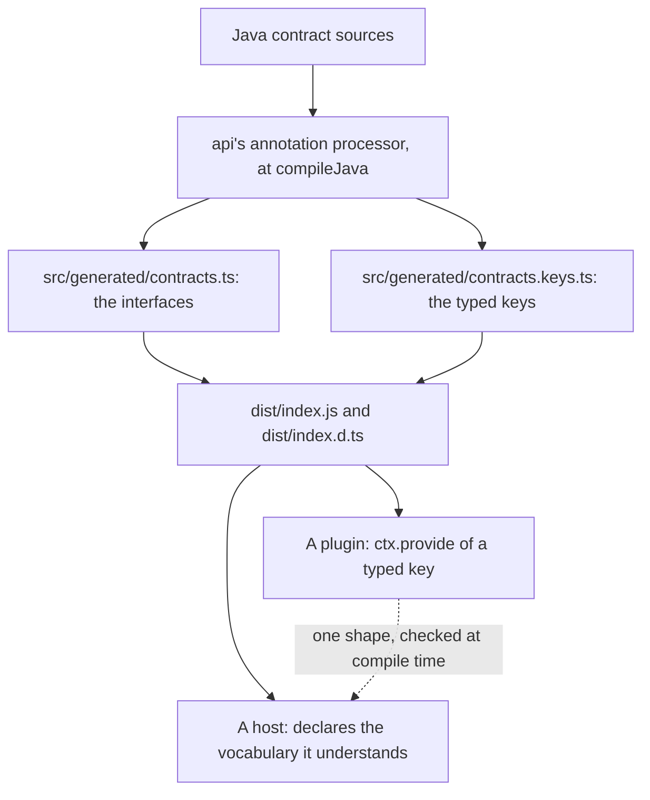

`{{ package_name }}` is the neutral third party the plugin-to-host contracts need. Every capability
a host consumes, every well-known service contract, and every ecosystem event topic is declared once
in Java and emitted to TypeScript, so a plugin and the host that loads it agree on one shape without
either importing the other.

## Under-the-Hood Architecture



## Structure

- `java/contracts/src/main/java/io/github/intisy/ai/contracts/ui/` - the shared settings and screen
  payloads every capability references
- `java/contracts/src/main/java/io/github/intisy/ai/contracts/capability/` - the capability
  interfaces a host consumes
- `java/contracts/src/main/java/io/github/intisy/ai/contracts/service/` - the well-known service
  contracts a plugin registers and another plugin asks for
- `java/contracts/src/main/java/io/github/intisy/ai/contracts/event/` - the payload of each
  ecosystem-owned event topic
- `java/contracts/src/main/java/io/github/intisy/ai/contracts/Contracts.java` - the typed keys
- `src/generated/` - the emitted TypeScript surface, committed so a consumer needs no JDK
- `src/index.ts` - the barrel
- `dist/` - compiled output (generated; never committed)

## Installation

As a submodule, for an app or library built in this ecosystem:

```bash
git submodule add https://github.com/intisy-ai/core-contracts core-contracts
```

From npm:

```bash
npm install @intisy-ai/core-contracts
```

## Configuration

None. This package is a contract: it has no runtime behaviour to configure.

## Logging

None. Nothing here runs.

## License

MIT
